# QTLink

**Lightweight open-source Modbus edge datalogger with store-and-forward to FTP/sFTP, MQTT, HTTP, InfluxDB. Runs on Raspberry Pi.**

[](https://github.com/gooduselabs/qtlink/actions/workflows/ci.yml)
· MIT License · Python 3.10+ · **[🇬🇧 English](#english) · [🇻🇳 Tiếng Việt](#tiếng-việt)**

<a id="english"></a>

QTLink polls Modbus TCP/RTU devices (analyzers, energy meters, inverters), aggregates the readings into fixed time slots, and forwards each slot to one or more **sinks**. Every sink has its own **SQLite store-and-forward queue**: if the network or the server is down, data is kept locally and resent **oldest first, without duplicates**, when the link comes back. A small built-in web dashboard shows live values, trends, the queue and alarms.

It is deliberately **not a SCADA/HMI**. It is the small, boring box at the edge that makes sure the data gets out.

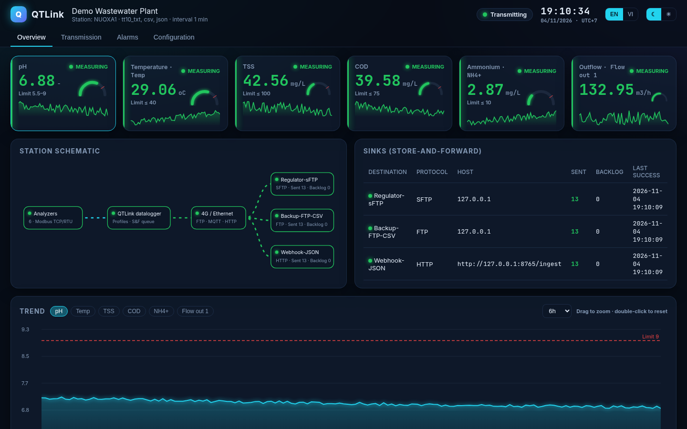

<p align="center">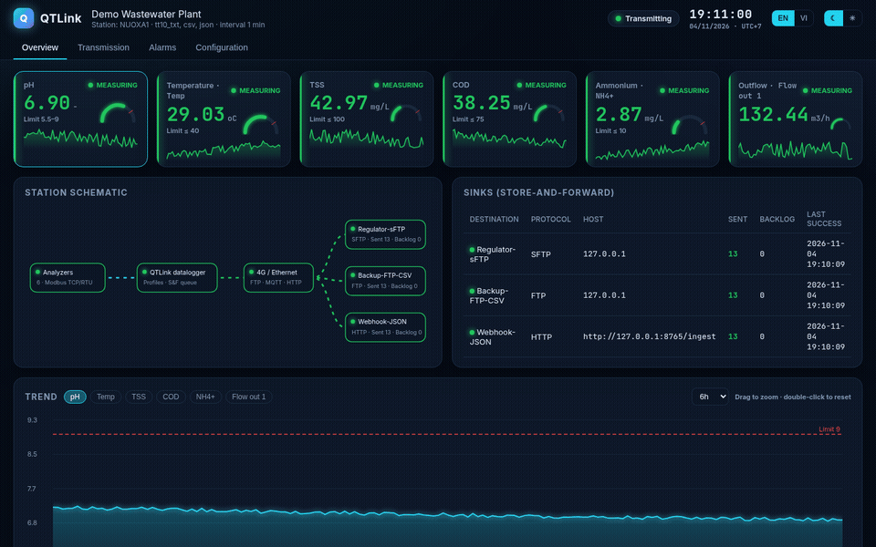 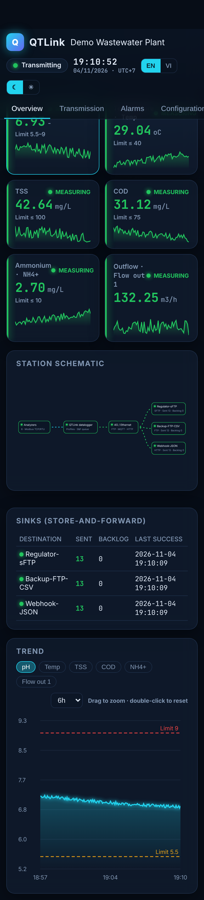</p>

## Features
- **Modbus TCP and RTU** (RS485-USB) via pymodbus. int16/uint16/int32/uint32/float32, word order, scale/offset, 4–20 mA linear scaling, SunSpec-style scale-factor registers, calibration/fault status registers.
- **Device register-map library** (`devices/*.yaml`): reference a template and pick points instead of typing register addresses. Every map cites the public manual it came from.
- **Output profiles (formats):** `csv`, `json`, `influx` (line protocol), and `tt10_txt` (Vietnam Circular 10/2021/TT-BTNMT, Appendix XV).
- **Sinks (transports):** `ftp`, `ftps`, `sftp`, `mqtt` (paho-mqtt, QoS 1, TLS), `http` (webhook POST, Bearer/Basic auth, custom headers), `influxdb` (v2 write API, or v1 with `db:`).
- **Store-and-forward:** one queue entry per (file, sink), oldest first, a failing sink stops for that round so order is preserved, attempts and last error recorded, ≥ 60 days local retention (configurable), outage warning after N hours.
- **Alarms:** high/low limits, device lost/reconnected, transmission outage.
- **Dashboard:** offline (no CDN), dark/light theme, English/Vietnamese toggle (English by default), mobile friendly, YAML config editor.
- **Batteries for demos:** Modbus simulator plus local FTP, sFTP and HTTP test servers, so you can try everything without hardware.

| Transmission | Alarms | Configuration |
|---|---|---|
| 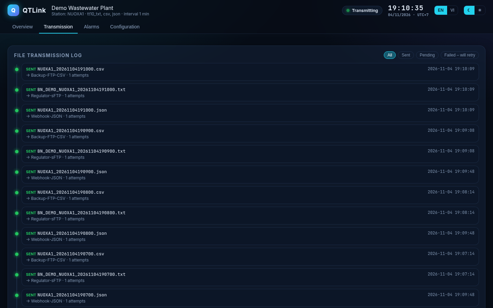 | 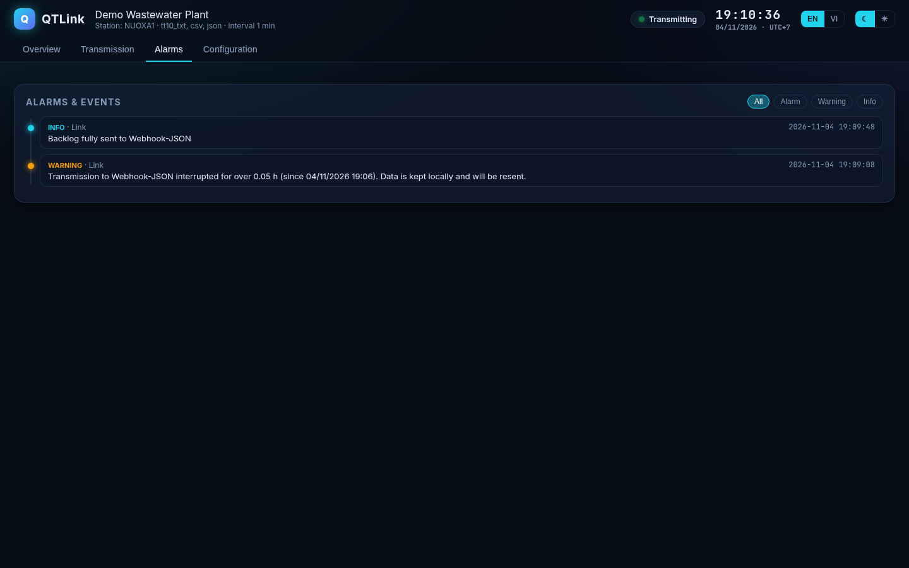 | 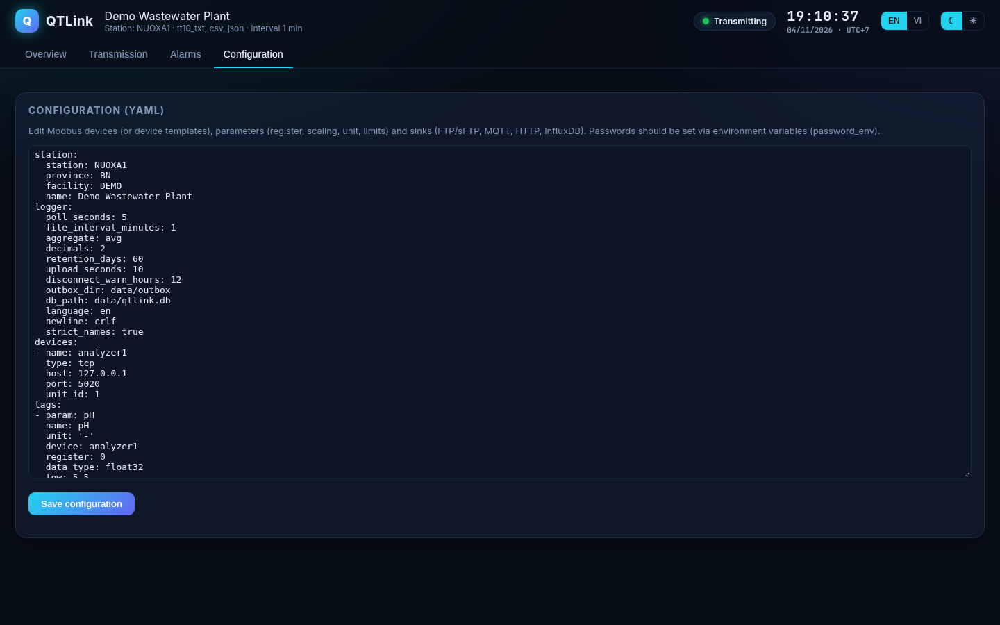 |

## 5-minute quick start
```bash
git clone https://github.com/gooduselabs/qtlink && cd qtlink
python3 -m venv .venv && . .venv/bin/activate
pip install -r requirements.txt
python -m qtlink demo        # simulator :5020, FTP :2121, sFTP :2222, HTTP :8765, dashboard :8080
```
Open http://localhost:8080. The English demo ("Demo Wastewater Plant") builds one slot per minute and sends it three ways:

| Sink | Protocol | Format | Where to look |
|---|---|---|---|
| `Regulator-sFTP` | sftp | `tt10_txt` | `data/server/sftp/NUOXA1/yyyy/mm/dd/` |
| `Backup-FTP-CSV` | ftp | `csv` | `data/server/ftp/NUOXA1/yyyy/mm/dd/` |
| `Webhook-JSON` | http | `json` | `data/server/http/` |

Kill a test server or unplug the network and watch the backlog grow in the dashboard, then drain in order when it comes back.

Windows: double-click `run-demo.bat`. Docker: `docker compose --profile demo up --build`. Vietnamese TT10 demo: `python -m qtlink demo -c config.demo.vi.yaml`.

## Configuration
```yaml
station: {station: SITE01, name: "Plant A"}
logger: {poll_seconds: 10, file_interval_minutes: 5, retention_days: 60, language: en}
devices:
  - name: main
    template: eastron_sdm630          # from devices/
    type: rtu
    serial_port: /dev/ttyUSB0
    baudrate: 9600
    unit_id: 1
    points: [voltage_l1, total_active_power, import_active_energy]   # or: all
tags:                                  # hand-written tags still work (register, data_type, scale, ...)
  - {param: pv_power, device: pv, point: ac_power, high: 10000}
sinks:                                 # `destinations:` (v0.1 name) is still accepted
  - {name: broker, protocol: mqtt, host: mqtt.example.com, port: 8883, tls: true,
     username: qtlink, password_env: QTLINK_MQTT_PASS, topic: "factory/{station}/energy", qos: 1}
  - {name: influx, protocol: influxdb, url: https://influx.example.com, org: my-org, bucket: energy, token_env: INFLUX_TOKEN}
  - {name: webhook, protocol: http, format: json, url: https://example.com/ingest, token_env: HOOK_TOKEN}
  - {name: archive, protocol: sftp, format: csv, host: files.example.com, username: qtlink, key_file: /etc/qtlink/id_rsa}
```
Full examples: [`config.example.yaml`](config.example.yaml) (energy meters → MQTT/InfluxDB/HTTP/sFTP) and [`config.example.tt10.yaml`](config.example.tt10.yaml) (Vietnam TT10). Secrets go in environment variables (`password_env`, `token_env`), never in the file. Default formats: file transports → `tt10_txt` (backward compatible), `mqtt`/`http` → `json`, `influxdb` → `influx`.

Run for real: `cp config.example.yaml config.yaml`, edit, then `python -m qtlink run -c config.yaml` (systemd, NSSM or `docker compose up -d qtlink` to start on boot).

### Device library
| Template | Device | Registers | Source |
|---|---|---|---|
| `eastron_sdm120` | Eastron SDM120 (1-phase meter) | V, A, W, VA, VAr, PF, Hz, import/export/total kWh, total kvarh | [Eastron protocol V2.4](https://www.eastroneurope.com/images/uploads/products/protocol/SDM120-MODBUS_Protocol.pdf) |
| `eastron_sdm630` | Eastron SDM630-Modbus V2 (3-phase meter) | per-phase V/A/W, total W/VA/VAr/PF, Hz, import/export/total kWh | [Eastron protocol V1.8](https://www.eastroneurope.com/images/uploads/products/protocol/SDM630_MODBUS_Protocol.pdf) |
| `schneider_pm5xxx` | Schneider PowerLogic PM5000 (basic) | currents, L-L/L-N voltages, total kW/kVAR/kVA, Hz | [Schneider PM5100/PM5300 register list](https://www.se.com/uk/en/download/document/PM5100-PM5300_PublicRegisterList/) |
| `sunspec_inverter_103` | Generic SunSpec inverter (model 103 int+SF after common model at 40000) | AC A, phase V, W, Hz, VA, VAr | [Fronius SunSpec int+SF map](https://www.forum-fronius.pl/wp-content/uploads/asgarosforum/2812/Inverter_register_map.pdf), [SunSpec](https://sunspec.org/sunspec-modbus-specifications/) |

Only addresses we could check against a public manual are included (e.g. PM5000 energy and power-factor registers are left out). Always verify on your own device; PRs with new maps are welcome (see [CONTRIBUTING.md](CONTRIBUTING.md)).

## Architecture
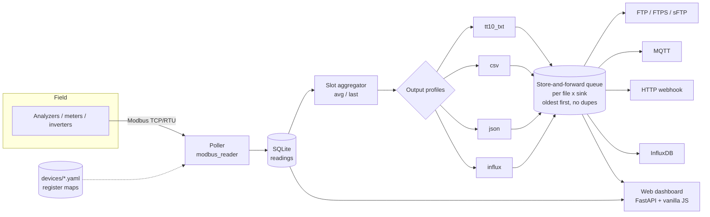

## How it compares
QTLink is **complementary** to full open-source SCADA/HMI projects, not a replacement:
- **[FUXA](https://github.com/frangoteam/FUXA)** is a web-based SCADA/HMI with a visual editor, many drivers and dashboards. Use it when operators need screens and control.
- **[PyScada](https://github.com/pyscada/PyScada)** is a Django-based SCADA system with a database, HMI and many protocols. Use it for plant-wide supervision.
- **QTLink** is a single small process for the edge: read Modbus, keep data safe locally, and forward it reliably in the format a regulator, a broker or a time-series database expects. It runs happily next to (or upstream of) FUXA, PyScada, Node-RED, Grafana or a cloud platform.

## Vietnam TT10/2021 profile
The original use case: automatic wastewater/stack monitoring stations that must send `.txt` files to the provincial authority in the format of Circular 10/2021/TT-BTNMT (Article 39, Appendix XV). Use `format: tt10_txt` with `station.province`, `station.facility` and `station.station`. Files look like `BN_GULB_NUOXA1_20261104183500.txt`, are uploaded to `Station/yyyy/mm/dd`, and an outage of more than 12 h raises the warning required by Article 39. See [docs/FORMAT.md](docs/FORMAT.md) and the Vietnamese section below. Set `TZ=Asia/Ho_Chi_Minh` (GMT+7) for this profile.

## Tests
```bash
pip install -r requirements-dev.txt && python -m pytest -q
```
The suite covers output formats, config backward compatibility and device templates, the HTTP and InfluxDB sinks against a local HTTP server, the MQTT sink against a local amqtt broker, store-and-forward ordering/no-duplicates/per-sink isolation, Modbus decoding, retention, and an end-to-end run (simulator → files → sFTP/FTP). CI runs it on every push. Screenshots and `docs/demo.gif` are regenerated with `python scripts/screenshots.py` while the demo runs.

## Built with AI assistance
In the interest of transparency: a large part of this code, the tests and the documentation was written with the help of an AI coding assistant, then reviewed, run and tested by the maintainer. Register maps were checked against the cited public manuals, but please verify them on real hardware and report any mistakes.

> ⚠️ Community software, no warranty, not certified by any authority. For regulatory use (e.g. TT10) confirm the configuration with the receiving authority first.

Author: Trần Đức Hải – GoodUseLabs · hai2000.dev@gmail.com · [Changelog](CHANGELOG.md) · [Contributing](CONTRIBUTING.md)

---

<a id="tiếng-việt"></a>
## 🇻🇳 Tiếng Việt

**Datalogger mã nguồn mở, miễn phí** để truyền dữ liệu **quan trắc tự động nước thải / khí thải** về **Sở TN&MT (nay là Sở NN&MT)** đúng **Thông tư 10/2021/TT-BTNMT** (Điều 39 + Phụ lục XV).

> **Thay datalogger 2G:** Việt Nam đã tắt sóng 2G từ 15/9/2026, nên nhiều datalogger môi trường cũ chỉ chạy 2G đã ngừng truyền. QTLink chạy trên **phần cứng rẻ** như Raspberry Pi 4/5, mini PC hoặc máy tính Windows có sẵn. Máy chỉ cần nối mạng **Ethernet hoặc router 4G** (có IP tĩnh như Sở yêu cầu), đọc analyzer qua **Modbus TCP/RTU (RS485-USB)** và truyền **FTP/FTPS/sFTP**.

Tác giả: Trần Đức Hải – GoodUseLabs · Giấy phép MIT

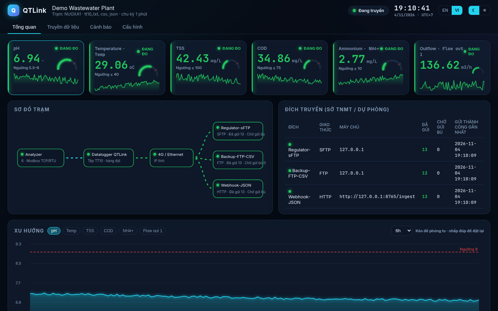

> **Mới ở v0.2:** QTLink trở thành datalogger biên đa dụng: định dạng TT10 là một *output profile* (`format: tt10_txt`), bên cạnh CSV/JSON/InfluxDB và các kênh truyền MQTT, HTTP/webhook, InfluxDB. Cấu hình TT10 cũ vẫn chạy nguyên vẹn. Giao diện mặc định tiếng Anh cho bản cài mới; đặt `logger.language: vi` hoặc bấm nút VI.

<p align="center"> 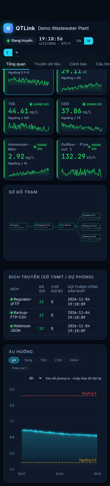</p>

#### Tính năng
- Đọc analyzer qua **Modbus TCP và RTU**. Danh sách thông số cấu hình được: mã thông số, thanh ghi, kiểu dữ liệu (int16/uint16/int32/uint32/float32), hệ số/offset hoặc 4–20 mA, đơn vị, ngưỡng, thanh ghi trạng thái hiệu chuẩn/lỗi.
- Tạo tệp `.txt` theo **Phụ lục XV**, mặc định **5 phút/tệp** (cấu hình được). Tên tệp ví dụ: `BN_GULB_NUOXA1_20261104183500.txt`. Mỗi dòng: `pH<TAB>7.40<TAB>-<TAB>20261104183500<TAB>00`.
- Gửi tới **nhiều đích** (Sở + dự phòng), vào thư mục `TramA/yyyy/mm/dd`. Có **hàng đợi gửi bù tự động** theo thứ tự thời gian và lưu trữ cục bộ **≥ 60 ngày** (tự dọn dữ liệu cũ hơn).
- **Báo động vượt ngưỡng**. **Cảnh báo khi gián đoạn truyền > 12 giờ**, kèm nhắc nghĩa vụ báo cáo theo Điều 39.
- **Dashboard kiểu SCADA** (song ngữ VI/EN, giao diện tối/sáng, chạy offline không cần CDN): thẻ thông số có đồng hồ + sparkline, sơ đồ trạm với luồng truyền động, biểu đồ xu hướng nhiều thông số có ngưỡng và phóng to, nhật ký truyền dạng timeline, danh sách cảnh báo theo mức độ, hiển thị tốt trên điện thoại.
- Có sẵn **bộ mô phỏng Modbus** và **máy chủ FTP/sFTP thử nghiệm** để demo khi không có thiết bị.

| Truyền dữ liệu | Cảnh báo | Cấu hình |
|---|---|---|
| 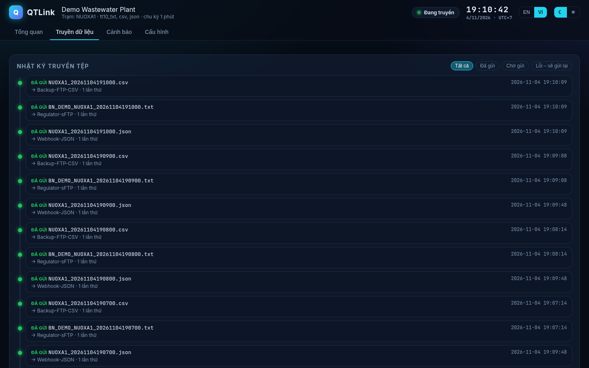 | 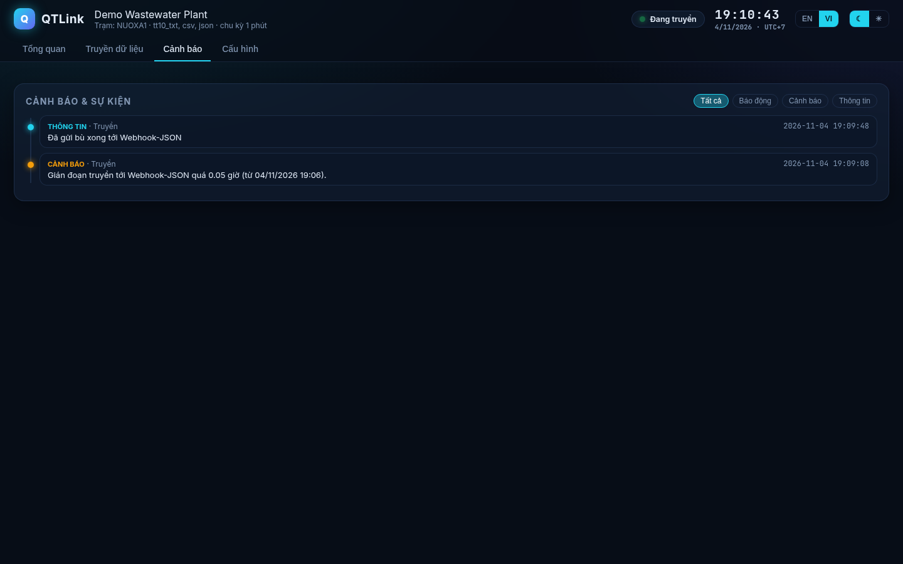 | 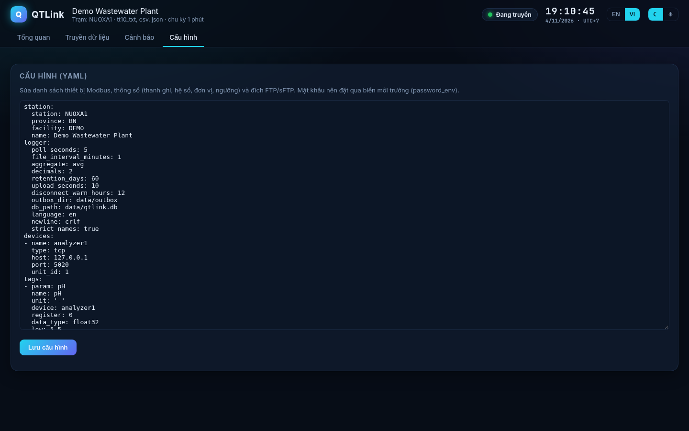 |

#### Chạy demo (5 phút)
**Windows:** cài Python 3.10+ (python.org) rồi bấm đúp `run-demo.bat` (demo tiếng Anh; bấm nút VI để đổi ngôn ngữ). Sau đó mở http://localhost:8080

**Linux / Raspberry Pi:**
```bash
python3 -m venv .venv && . .venv/bin/activate
pip install -r requirements.txt
python -m qtlink demo -c config.demo.vi.yaml   # cấu hình demo tiếng Việt (TT10)
```
Tệp tạo ra nằm ở `data/outbox/`. Tệp "Sở" nhận được nằm ở `data/server/sftp/NUOXA1/yyyy/mm/dd/`. Bản demo tạo 1 tệp mỗi phút.

**Docker:** `docker compose --profile demo up --build`

#### Chạy thật
1. `cp config.example.tt10.yaml config.yaml` rồi sửa mã tỉnh/cơ sở/trạm (Sở cấp), thiết bị Modbus, thông số và máy chủ Sở.
2. Đặt mật khẩu bằng biến môi trường, **không ghi vào file**: `export QTLINK_SFTP_PASS=...` (Windows: `set QTLINK_SFTP_PASS=...`).
3. Chạy `python -m qtlink run -c config.yaml` (Windows: `run.bat`; Docker: `docker compose up -d qtlink`).
4. Đồng bộ giờ **NTP, GMT+7** (bắt buộc theo TT10). Trên Pi dùng `timedatectl set-timezone Asia/Ho_Chi_Minh`.
5. Muốn tự chạy khi khởi động: dùng systemd (Linux), Task Scheduler / NSSM (Windows) hoặc `restart: unless-stopped` (Docker).

Modbus RTU: khai báo `type: rtu`, `serial_port: COM3` hoặc `/dev/ttyUSB0`, cùng `baudrate` và `parity`.

#### Kiểm thử
```bash
pip install -r requirements-dev.txt && python -m pytest -q
```
Các test kiểm tra định dạng tệp, hàng đợi gửi bù (đúng thứ tự, không gửi trùng), cảnh báo 12 giờ, thang đo Modbus, dọn dữ liệu 60 ngày và luồng end-to-end (sim → tệp → sFTP/FTP).

#### Định dạng & nguồn
Xem [docs/FORMAT.md](docs/FORMAT.md). Tài liệu này dẫn nguồn Phụ lục XV gốc (lưu ở `docs/sources/`), liệt kê các điểm **chưa quy định rõ** (đều cấu hình được) và lưu ý các bài viết thương mại có thông tin mâu thuẫn.

> ⚠️ QTLink là phần mềm cộng đồng, chưa được cơ quan nhà nước chứng nhận. Hãy xác nhận cấu hình với Sở trước khi nghiệm thu. TT10 cũng yêu cầu niêm phong cổng không dùng, có camera RTSP và các yêu cầu phần cứng khác; những phần này nằm ngoài phạm vi phần mềm.

#### Liên hệ
Facebook: [Good Use Labs](https://www.facebook.com/gooduselabs) · Email: hai2000.dev@gmail.com

Dự án mới, mong nhận góp ý/issue/PR. Định dạng tệp và cách kết nối nên được **xác nhận với từng Sở** trước khi chạy chính thức.

