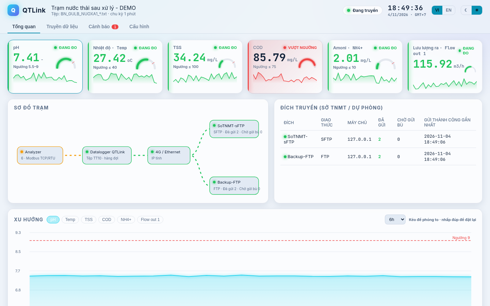

# QTLink · QuanTrắc Link

**[🇻🇳 Tiếng Việt](#tiếng-việt) · [🇬🇧 English](#english)**

<a id="tiếng-việt"></a>
## 🇻🇳 Tiếng Việt

**Datalogger mã nguồn mở, miễn phí** để truyền dữ liệu **quan trắc tự động nước thải / khí thải** về **Sở TN&MT (nay là Sở NN&MT)** đúng **Thông tư 10/2021/TT-BTNMT** (Điều 39 + Phụ lục XV).

> **Thay datalogger 2G:** Việt Nam đã tắt sóng 2G từ 15/9/2026, nên nhiều datalogger môi trường cũ chỉ chạy 2G đã ngừng truyền. QTLink chạy trên **phần cứng rẻ** như Raspberry Pi 4/5, mini PC hoặc máy tính Windows có sẵn. Máy chỉ cần nối mạng **Ethernet hoặc router 4G** (có IP tĩnh như Sở yêu cầu), đọc analyzer qua **Modbus TCP/RTU (RS485-USB)** và truyền **FTP/FTPS/sFTP**.

Tác giả: Trần Đức Hải – GoodUseLabs · Giấy phép MIT


<p align="center"> </p>

### Tính năng
- Đọc analyzer qua **Modbus TCP và RTU**. Danh sách thông số cấu hình được: mã thông số, thanh ghi, kiểu dữ liệu (int16/uint16/int32/uint32/float32), hệ số/offset hoặc 4–20 mA, đơn vị, ngưỡng, thanh ghi trạng thái hiệu chuẩn/lỗi.
- Tạo tệp `.txt` theo **Phụ lục XV**, mặc định **5 phút/tệp** (cấu hình được). Tên tệp ví dụ: `BN_GULB_NUOXA1_20261104183500.txt`. Mỗi dòng: `pH<TAB>7.40<TAB>-<TAB>20261104183500<TAB>00`.
- Gửi tới **nhiều đích** (Sở + dự phòng), vào thư mục `TramA/yyyy/mm/dd`. Có **hàng đợi gửi bù tự động** theo thứ tự thời gian và lưu trữ cục bộ **≥ 60 ngày** (tự dọn dữ liệu cũ hơn).
- **Báo động vượt ngưỡng**. **Cảnh báo khi gián đoạn truyền > 12 giờ**, kèm nhắc nghĩa vụ báo cáo theo Điều 39.
- **Dashboard kiểu SCADA** (song ngữ VI/EN, giao diện tối/sáng, chạy offline không cần CDN): thẻ thông số có đồng hồ + sparkline, sơ đồ trạm với luồng truyền động, biểu đồ xu hướng nhiều thông số có ngưỡng và phóng to, nhật ký truyền dạng timeline, danh sách cảnh báo theo mức độ, hiển thị tốt trên điện thoại.
- Có sẵn **bộ mô phỏng Modbus** và **máy chủ FTP/sFTP thử nghiệm** để demo khi không có thiết bị.

| Truyền dữ liệu | Cảnh báo | Cấu hình |
|---|---|---|
|  |  |  |

### Chạy demo (5 phút)
**Windows:** cài Python 3.10+ (python.org) rồi bấm đúp `run-demo.bat`. Sau đó mở http://localhost:8080

**Linux / Raspberry Pi:**
```bash
python3 -m venv .venv && . .venv/bin/activate
pip install -r requirements.txt
python -m qtlink demo          # sim Modbus :5020 + FTP :2121 + sFTP :2222 + web :8080
```
Tệp tạo ra nằm ở `data/outbox/`. Tệp "Sở" nhận được nằm ở `data/server/sftp/NUOXA1/yyyy/mm/dd/`. Bản demo tạo 1 tệp mỗi phút.

**Docker:** `docker compose --profile demo up --build`

### Chạy thật
1. `cp config.example.yaml config.yaml` rồi sửa mã tỉnh/cơ sở/trạm (Sở cấp), thiết bị Modbus, thông số và máy chủ Sở.
2. Đặt mật khẩu bằng biến môi trường, **không ghi vào file**: `export QTLINK_SFTP_PASS=...` (Windows: `set QTLINK_SFTP_PASS=...`).
3. Chạy `python -m qtlink run -c config.yaml` (Windows: `run.bat`; Docker: `docker compose up -d qtlink`).
4. Đồng bộ giờ **NTP, GMT+7** (bắt buộc theo TT10). Trên Pi dùng `timedatectl set-timezone Asia/Ho_Chi_Minh`.
5. Muốn tự chạy khi khởi động: dùng systemd (Linux), Task Scheduler / NSSM (Windows) hoặc `restart: unless-stopped` (Docker).

Modbus RTU: khai báo `type: rtu`, `serial_port: COM3` hoặc `/dev/ttyUSB0`, cùng `baudrate` và `parity`.

### Kiểm thử
```bash
pip install -r requirements-dev.txt && python -m pytest -q
```
Các test kiểm tra định dạng tệp, hàng đợi gửi bù (đúng thứ tự, không gửi trùng), cảnh báo 12 giờ, thang đo Modbus, dọn dữ liệu 60 ngày và luồng end-to-end (sim → tệp → sFTP/FTP).

### Định dạng & nguồn
Xem [docs/FORMAT.md](docs/FORMAT.md). Tài liệu này dẫn nguồn Phụ lục XV gốc (lưu ở `docs/sources/`), liệt kê các điểm **chưa quy định rõ** (đều cấu hình được) và lưu ý các bài viết thương mại có thông tin mâu thuẫn.

> ⚠️ QTLink là phần mềm cộng đồng, chưa được cơ quan nhà nước chứng nhận. Hãy xác nhận cấu hình với Sở trước khi nghiệm thu. TT10 cũng yêu cầu niêm phong cổng không dùng, có camera RTSP và các yêu cầu phần cứng khác; những phần này nằm ngoài phạm vi phần mềm.

### Liên hệ
Facebook: [Good Use Labs](https://www.facebook.com/gooduselabs) · Email: hai2000.dev@gmail.com

Dự án mới, mong nhận góp ý/issue/PR. Định dạng tệp và cách kết nối nên được **xác nhận với từng Sở** trước khi chạy chính thức.

### English
QTLink is a free, MIT-licensed datalogger for Vietnamese automatic environmental (wastewater/stack) monitoring stations. It reads analyzers over Modbus TCP/RTU, writes TT 10/2021/TT-BTNMT (Appendix XV) `.txt` files, and uploads them via FTP/FTPS/sFTP to the provincial authority, with a resend queue, 60-day local archive, threshold/outage alarms and a Vietnamese web dashboard. Runs on Raspberry Pi, mini PC or Windows — a replacement path for 2G dataloggers after Vietnam's 2G shutdown (15 Sep 2026). Try `python -m qtlink demo` and open http://localhost:8080.

---

<a id="english"></a>
## 🇬🇧 English

**Free, open-source datalogger** that transmits **automatic wastewater / stack-emission monitoring data** to the provincial **Department of Natural Resources and Environment (DONRE, now the Department of Agriculture and Environment)** in the format required by Vietnam's **Circular 10/2021/TT-BTNMT** (Article 39 + Appendix XV).

> **2G datalogger replacement:** Vietnam switched off 2G on 15 Sep 2026, so many legacy 2G-only environmental dataloggers stopped transmitting. QTLink runs on **cheap hardware** such as a Raspberry Pi 4/5, a mini PC or an existing Windows PC. It only needs **Ethernet or a 4G router** (with the static IP the Department requires), reads analyzers over **Modbus TCP/RTU (RS485-USB)** and uploads via **FTP/FTPS/sFTP**.

Author: Trần Đức Hải – GoodUseLabs · MIT License


<p align="center"> </p>

### Features
- Reads analyzers over **Modbus TCP and RTU**. Configurable parameter list: parameter code, register, data type (int16/uint16/int32/uint32/float32), scale/offset or 4–20 mA, unit, limits, calibration/fault status register.
- Generates `.txt` files per **Appendix XV**, **5 minutes per file** by default (configurable). Example file name: `BN_GULB_NUOXA1_20261104183500.txt`. Each line: `pH<TAB>7.40<TAB>-<TAB>20261104183500<TAB>00`.
- Uploads to **multiple destinations** (Department + backup) into `TramA/yyyy/mm/dd`. Includes an **automatic backfill queue** in chronological order and local storage of **≥ 60 days** (older data is purged automatically).
- **Over-limit alarms**. **Warning when transmission is interrupted > 12 hours**, with a reminder of the reporting obligation under Article 39.
- **SCADA-style dashboard** (bilingual VI/EN toggle, dark/light theme, fully offline – no CDN): parameter cards with gauge + sparkline and glowing status (normal / over-limit / calibration / fault), station schematic with animated transmission flow, multi-parameter trend chart with limit lines and drag-to-zoom, upload log timeline, severity-coloured alarm list, mobile-friendly layout, YAML configuration editor.
- Built-in **Modbus simulator** and **test FTP/sFTP servers** for demos without hardware.

| Transmission | Alarms | Configuration |
|---|---|---|
|  |  |  |

Light theme: 

### Run the demo (5 minutes)
**Windows:** install Python 3.10+ (python.org) and double-click `run-demo.bat`. Then open http://localhost:8080

**Linux / Raspberry Pi:**
```bash
python3 -m venv .venv && . .venv/bin/activate
pip install -r requirements.txt
python -m qtlink demo          # Modbus sim :5020 + FTP :2121 + sFTP :2222 + web :8080
```
Generated files are in `data/outbox/`. Files "received by the Department" are in `data/server/sftp/NUOXA1/yyyy/mm/dd/`. The demo creates one file per minute.

**Docker:** `docker compose --profile demo up --build`

### Production use
1. `cp config.example.yaml config.yaml` and edit the province/facility/station codes (issued by the Department), Modbus devices, parameters and the Department's server.
2. Set passwords via environment variables, **never in the file**: `export QTLINK_SFTP_PASS=...` (Windows: `set QTLINK_SFTP_PASS=...`).
3. Run `python -m qtlink run -c config.yaml` (Windows: `run.bat`; Docker: `docker compose up -d qtlink`).
4. Sync time via **NTP, GMT+7** (mandatory under Circular 10). On a Pi: `timedatectl set-timezone Asia/Ho_Chi_Minh`.
5. To start on boot: use systemd (Linux), Task Scheduler / NSSM (Windows) or `restart: unless-stopped` (Docker).

Modbus RTU: set `type: rtu`, `serial_port: COM3` or `/dev/ttyUSB0`, plus `baudrate` and `parity`.

The dashboard language (VI/EN) and theme are toggled in the header and remembered in the browser (localStorage).

### Tests
```bash
pip install -r requirements-dev.txt && python -m pytest -q
```
Tests cover the file format, the backfill queue (correct order, no duplicates), the 12-hour warning, Modbus scaling, 60-day purge and the end-to-end flow (sim → file → sFTP/FTP).

Screenshots and `docs/demo.gif` are regenerated with `python scripts/screenshots.py` while the demo is running (needs Playwright and ffmpeg).

### Format & sources
See [docs/FORMAT.md](docs/FORMAT.md) (Vietnamese). It cites the original Appendix XV (stored in `docs/sources/`), lists the points that are **not clearly specified** (all configurable) and notes commercial articles with conflicting information.

> ⚠️ QTLink is community software and has not been certified by any government agency. Confirm your configuration with the Department before acceptance. Circular 10 also requires sealing unused ports, an RTSP camera and other hardware requirements; these are outside the scope of this software.

### Contact
Facebook: [Good Use Labs](https://www.facebook.com/gooduselabs) · Email: hai2000.dev@gmail.com

This is a new project – feedback, issues and PRs are welcome. The file format and connection details should be **confirmed with each Department** before going live.
